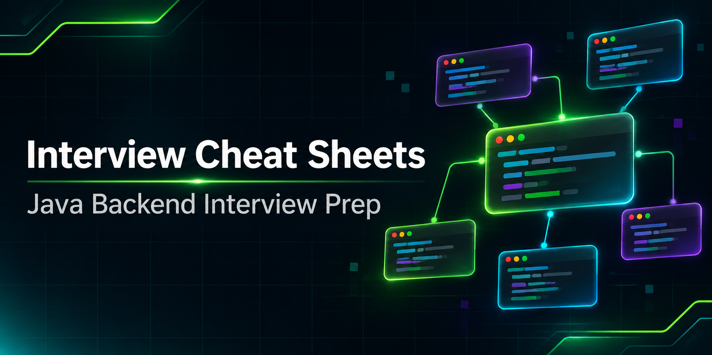

Quick-revision cheat sheets for Java backend interviews: short keywords, plain-English meanings and the traps that catch people out.

## Available cheat sheets

| Topic | What's inside | Last updated |
|---|---|---|
| [Spring Boot Annotations](spring-boot-annotations/) | About 60 annotations in 9 groups, for Spring Boot 3.x & 4.x | Nov 2026 |

More topics (SQL, Java) will be added over time.

## How to use
1. Open a topic folder and download the PDF.
2. Read one group at a time and try to recall each meaning before checking.
3. Try the traps yourself before reading the answers.

## Corrections welcome
Found a mistake or something outdated? Open an issue. Each sheet has a "last updated" date.

## Author
Harsha Vardhan • [GitHub](https://github.com/Harshavardhan3535) • [LinkedIn](https://www.linkedin.com/in/srikakulapu-harshavardhan-6367bb28b)

*Unofficial notes, not affiliated with the Spring project or any other project mentioned.*
